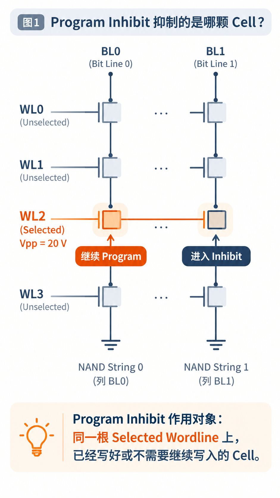
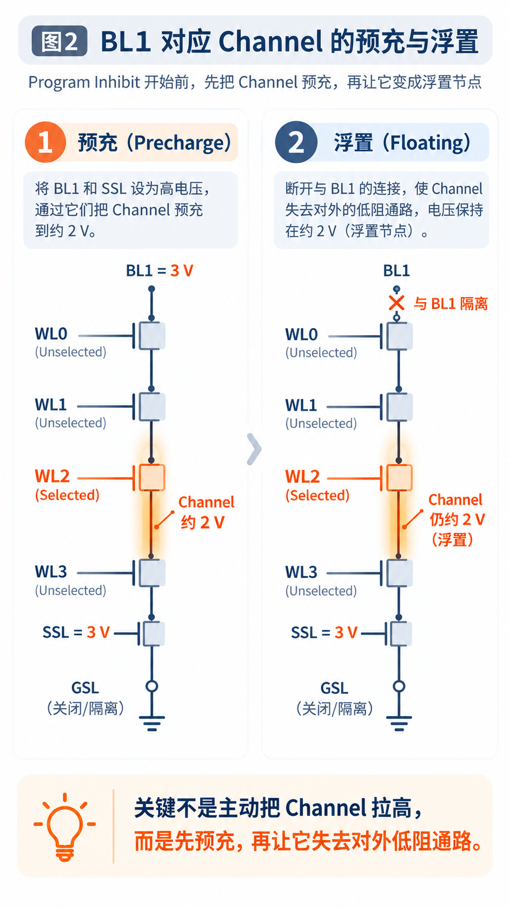
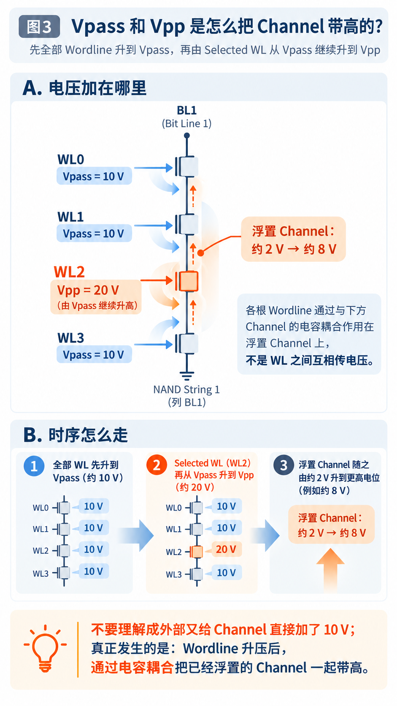

&nbsp;

<section style="font-family: -apple-system-font, BlinkMacSystemFont, &#39;Helvetica Neue&#39;, &#39;PingFang SC&#39;, &#39;Hiragino Sans GB&#39;, &#39;Microsoft YaHei UI&#39;, &#39;Microsoft YaHei&#39;, Arial, sans-serif;font-size: 16px;line-height: 1.75;text-align: left;">
<em style="font-style: italic;font-size: inherit;">全文约 2900 字｜阅读约 15 分钟</em>

上一篇讲完 Program，我们留下了一个问题：同一根 Wordline已经加上了高压，写好的 Cell要怎么停下来？

把高压撤掉似乎最简单。可高压一撤，其他还没写完的 Cell 怎么办？

NAND 并没有这么做。它靠的是 Program Inhibit（编程抑制）。

不过，在研究怎么抑制之前，得先把另一个容易混淆的问题说清楚：<strong style="color: #0F4C81;font-weight: bold;font-size: inherit;">到底是哪颗 Cell 需要被抑制？</strong>

<h2 data-heading="true" style="display: table;padding: 0 0.2em;margin: 4em auto 2em;color: #fff;background: #0F4C81;font-size: 19.2px;font-weight: bold;text-align: center;">一、同一根 Wordline，有的继续写，有的需要停</h2>

先把 NAND 阵列缩成一张能看清的小图。

假设有 WL0、WL1、WL2、WL3 四根 Wordline，以及分别连接 BL0、BL1、BL2、BL3 的四条 NAND String。Wordline 横向连接各颗 Cell 的 Control Gate；每条 String 由多个 Cell 串联组成，一端连接对应的 Bitline。

现在要对 WL2 进行 Program。假设这次编程电压是 20 V，那么 WL2×BL0、WL2×BL1 这两颗 Cell 的 Control Gate，都会承受相同的编程高压。

可两颗 Cell 的情况完全不同。

BL0 对应的 Cell 还没有写到目标状态，需要继续 Program；BL1 对应的 Cell 已经通过 Verify，不该继续写了。

如果继续给 WL2 加压，BL0 可以继续写，但 BL1 呢？它已经达到了目标 Vth（Threshold Voltage，阈值电压），如果电子继续注入，Vth 就可能超过目标范围。

问题就卡在这里。

我们很容易把 Program Inhibit 理解成保护那些位于相邻 Wordline 上的 Cell，但这并不是这里讨论的编程抑制对象。

<strong style="color: #0F4C81;font-weight: bold;font-size: inherit;">真正需要 Inhibit 的，是同一根 Selected Wordline上，已经写好或者本来就不需要写入的 Cell。</strong>

<section style="text-align: center;" nodeleaf=""></section>
<h2 data-heading="true" style="display: table;padding: 0 0.2em;margin: 4em auto 2em;color: #fff;background: #0F4C81;font-size: 19.2px;font-weight: bold;text-align: center;">二、高压撤不掉，那就从 Channel 想办法</h2>

WL2 上的高压不能单独撤掉，因为整根 Wordline 是共用的。那还能改变什么？

上一篇讲过 F-N Tunneling：电子能够穿过 Tunnel Oxide（隧穿氧化层）进入 Floating Gate（浮栅），依靠的是氧化层上足够强的电场。

这里先以 Floating Gate NAND 为例。对于 Charge Trap（电荷俘获）结构的 NAND，电子存储的位置虽然不同，但通过 Channel 升压减弱编程电场的基本思路仍然适用。

Control Gate 电位很高、Channel（沟道）电位很低，就有利于形成较强的编程电场。

那如果 Control Gate 还是 20 V，却把 Channel 电位也抬高呢？

氧化层上的有效电场就会减弱，电子也就不那么容易继续注入存储层。

Program Inhibit 的基本思路，其实就在这里。

至于哪条 String 继续写、哪条进入抑制，则由 Page Buffer（页缓冲电路）根据写入数据和 Verify 结果配合控制。

BL0 还需要写入，就让对应的 Channel 保持较低电位；BL1 已经到位，就设法把它的 Channel 电位抬高。同一根 Wordline 上的两颗 Cell，虽然 Control Gate 电压一样，但 Channel 电位不同，编程效果也就不同。

听起来似乎不复杂。真正的问题是：

<strong style="color: #0F4C81;font-weight: bold;font-size: inherit;">NAND 到底怎么把 BL1 的 Channel 电位抬高？</strong>

<h2 data-heading="true" style="display: table;padding: 0 0.2em;margin: 4em auto 2em;color: #fff;background: #0F4C81;font-size: 19.2px;font-weight: bold;text-align: center;">三、先充一点，再把 Channel 浮置起来</h2>

最直观的想法，是直接从 Bitline 给 Channel 加高压。

早期 NAND 确实采用过类似的抑制方式。不过，通过外围电路提供较高的 Channel 电压，会增加电路设计和器件应力方面的负担。

为了避免直接向 Channel 施加较高电压，NAND 发展出了 Self-Boosted Program Inhibit（SBPI，自升压编程抑制）这样的方案：先给 Channel 一个初始电位，再把它隔离，利用后续 Wordline 的升压进一步提高 Channel 电位。

我们继续看需要 Inhibit 的 BL1。

一条 NAND String 两端各有一个选择晶体管。靠近 Bitline 的由 SSL（String Select Line，串选择线）控制，靠近 Source Line（源线）的由 GSL（Ground Select Line，地选择线）控制。

先不用研究它们内部有多复杂，把它们当成两个开关就行。

假设 BL1 和 SSL 都是 3 V，选择晶体管的阈值电压约为 1 V。

Channel 一开始电位比较低，Bitline 可以通过选择晶体管对它进行预充。随着 Channel 电位逐渐升高，选择晶体管的有效栅源电压越来越小，导通能力也随之减弱。

在这个简化例子中，当 Channel 接近约 2 V 时，选择晶体管便不再明显导通。

这里有个很值得注意的细节：SSL 并没有主动从 3 V 降到 0 V。它的电压仍然保持不变，变化的是 Channel 电位。Channel 越升越高，选择晶体管的有效栅源电压反而越来越小，最后便逐渐截止。

再加上 NAND String 的另一端也保持隔离，Channel 就成了 Floating Node（浮置节点），不再通过低阻抗通路连接外部电源或地，电荷难以自由流入、流出。

但这时候 Channel 才大约 2 V。两端都已经隔离了，后面还怎么继续升压？

<section style="text-align: center;" nodeleaf=""></section>
<h2 data-heading="true" style="display: table;padding: 0 0.2em;margin: 4em auto 2em;color: #fff;background: #0F4C81;font-size: 19.2px;font-weight: bold;text-align: center;">四、Vpass 不只是让其他 Cell 导通</h2>

答案就在 Wordline 上。

Program 时，并不是只有 WL2 需要施加电压。未选中的 WL0、WL1、WL3，也需要施加 Vpass（Pass Voltage，导通电压）。

原因并不复杂：NAND String 中的 Cell 是串联的，如果其他 Cell 没有充分导通，即使 BL0 已经被拉到低电位，低电位也难以传递到 WL2 下方的 Channel。

所以，对于需要继续 Program 的 BL0，Vpass 的作用是让其他 Cell 导通，为目标 Cell 建立低电位通路。

但对于已经浮置的 BL1，Vpass 还能起到另一个作用。

我们先想象一个普通电容器：两块金属板中间隔着绝缘材料，其中一块金属板的电压升高，如果另一块金属板处于浮置状态，它的电位也可能跟着升高。

两块金属板不需要接触，电子也不需要穿过绝缘材料。这就是 Capacitive Coupling（电容耦合）。

NAND 的 Control Gate 和 Channel 之间，同样存在电容耦合。

在经典的整串自升压方案中，Channel 预充并浮置之后，<strong style="color: #0F4C81;font-weight: bold;font-size: inherit;">所有 Wordline 会先升到 Vpass，例如 10 V，包括本次选中的 WL2。</strong>

此时 BL0 和 BL1 承受的 Wordline 电压是相同的，但 Channel 的状态却不同。

BL0 的 Channel 存在通向低电位的导通路径，因此电位能够保持较低；BL1 的 Channel 已经浮置，当 Wordline 电压上升时，电容耦合就会把它的电位一起抬高。

这里并不是 WL0 把电压传给 WL1，再由 WL1 传给 WL2。是各根 Wordline 都通过自身与 Channel 之间的电容耦合，对浮置 Channel 产生作用。

等所有 Wordline 升到 Vpass 以后，才轮到 WL2 进一步升压。

WL0、WL1、WL3 继续保持约 10 V，而作为 Selected Wordline 的 WL2，会从 Vpass 进一步升到 Vpp（Program Voltage），例如 20 V。

WL2 这次额外升压，也会通过电容耦合进一步影响浮置 Channel 的电位。

所以 Channel 并不是先被外部电源加到 2 V，再由另一路电源直接加到 8 V。它是先通过 Bitline 预充，再进入浮置状态，随后随着 Wordline 电压升高，通过电容耦合被带到更高的电位。

在这个例子中，Channel 可能从约 2 V 升到约 8 V。具体能够升到多少，取决于 NAND 的结构、电容耦合、泄漏以及实际偏压条件。这些电压只是便于理解的示例，并不是所有 NAND 都采用相同的时序与电压。

现在回头看 Vpass，它的两个作用就清楚了。

对于正常 Program 的 String，Vpass 让未选中的 Cell 导通，帮助建立低电位通路；对于已经浮置的 Inhibit String，Wordline 升到 Vpass 的过程，还能通过电容耦合抬高 Channel。

<strong style="color: #0F4C81;font-weight: bold;font-size: inherit;">同样的 Wordline 电压，却产生了两种不同的结果。差别不在 Wordline 上，而在 Channel 是否处于浮置状态。</strong>

<section style="text-align: center;" nodeleaf=""></section>
<h2 data-heading="true" style="display: table;padding: 0 0.2em;margin: 4em auto 2em;color: #fff;background: #0F4C81;font-size: 19.2px;font-weight: bold;text-align: center;">五、可是 20 V 对 8 V，电子真的不会进去了吗？</h2>

讲到这里，还有一个问题。

WL2 仍然是 20 V，Channel 即使升到了 8 V，两者不还是相差 12 V 吗？

电子难道就完全不会进入 Floating Gate 了？

当然不是绝对为零。

首先，20 V 减去 8 V，并不等于 Tunnel Oxide 两端实际承受的电压。Control Gate 与 Channel 之间还有 Floating Gate、绝缘层以及相应的电容分压，FG 中原有的电荷也会影响氧化层上的实际电场。

其次，F-N 隧穿电流对电场非常敏感。电场减弱一些，电子注入电流就可能大幅下降。

所以 Program Inhibit 的目标，并不是让电子注入在数学意义上完全归零，而是尽可能减弱不希望发生的电子注入，使已经写好的 Cell 不会因为后续 Program Pulse而产生不可接受的 Vth 变化。

当然，如果 Channel 升压不充分，或者浮置期间发生电荷泄漏，抑制效果就可能减弱，原本不需要继续写入的 Cell 仍然可能受到影响。

这就涉及 Program Disturb，后面可以单独讨论。

<h2 data-heading="true" style="display: table;padding: 0 0.2em;margin: 4em auto 2em;color: #fff;background: #0F4C81;font-size: 19.2px;font-weight: bold;text-align: center;">六、现在可以回答上一篇的问题了</h2>

开头那两颗 Cell，WL2×BL0 还没有写完，WL2×BL1 已经通过 Verify。

它们共用 WL2，承受相同的编程高压，却不需要一起写、一起停。

BL0 的 Channel 保持较低电位，电子继续注入存储层；BL1 的 Channel 则经过预充、浮置和自升压，让电子注入受到强烈抑制。

这样，已经写好的 Cell 就能在后续编程脉冲中停下来，没写完的继续写。

这也正好接上上一篇 ISPP（Incremental Step Pulse Programming，增量步进脉冲编程）留下的问题：每次 Verify 之后，达到目标的 Cell 可以转入 Inhibit，其余 Cell 则继续接受后续的 Program Pulse。

<blockquote style="font-style: normal;padding: 1em;border-left: 4px solid #0F4C81;border-radius: 6px;color: #3f3f3f;background: #f7f7f7;margin-bottom: 1em;margin-left: 0;margin-right: 0;margin-top: 0;">
<strong style="color: #0F4C81;font-weight: bold;font-size: inherit;">同一根 Wordline 共享编程高压，并不意味着所有 Cell 都必须继续写入。Program Inhibit 通过改变不同 NAND String 的 Channel 电位，让需要写入的继续写，让已经到位的停下来。</strong>
</blockquote>

谢谢你读我的文章
</section>

&nbsp;

<mp-style-type data-value="3"></mp-style-type>

