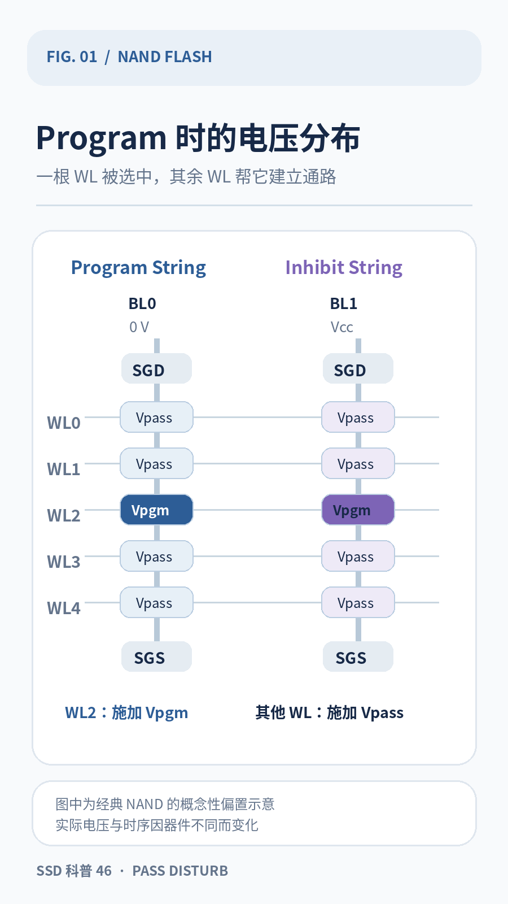
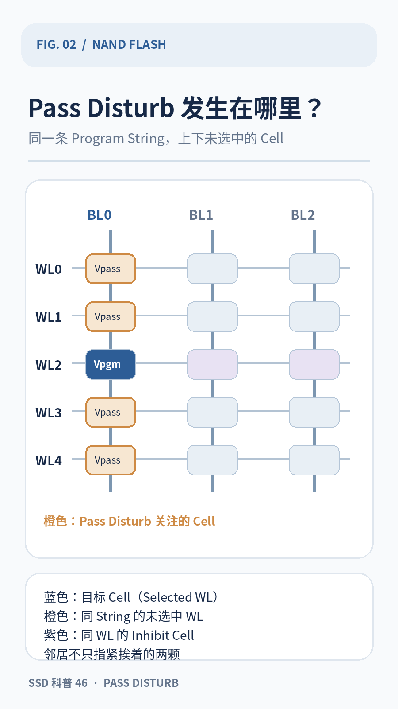
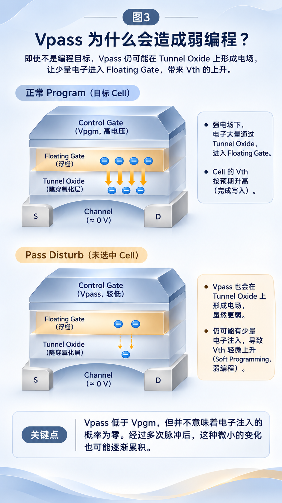
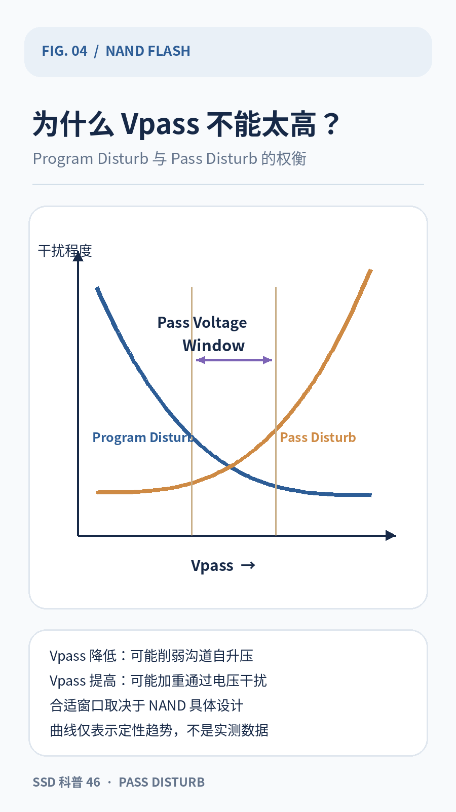

&nbsp;
<section style="font-family: -apple-system-font, BlinkMacSystemFont, &#39;Helvetica Neue&#39;, &#39;PingFang SC&#39;, &#39;Hiragino Sans GB&#39;, &#39;Microsoft YaHei UI&#39;, &#39;Microsoft YaHei&#39;, Arial, sans-serif;font-size: 16px;line-height: 1.75;text-align: left;">
上一篇讲 Program Inhibit（编程抑制）时，我们已经认识了 Vpass。

它有两个作用：对于需要 Program 的 NAND String，它让其他 Cell 保持导通；对于需要 Inhibit 的 NAND String，它又参与 Channel Boosting（沟道升压），帮助那些不应该被编程的 Cell 避免电子注入。

但当时还有一个问题没有继续往下讲。

那些只是负责导通的 Cell，真的完全不会受到影响吗？

我们知道，NAND 的 Program 依靠电场让电子穿过 Tunnel Oxide（隧穿氧化层），进入 Floating Gate（浮栅）。可 Vpass 本身也是一个正电压，它同样可能在 Tunnel Oxide 上形成电场。

既然如此，<strong style="color: #0F4C81;font-weight: bold;font-size: inherit;">那些没有被选中的 Cell，会不会也有少量电子被意外写进去？</strong>

答案是有可能。

这种现象就叫 Pass Disturb，也叫 Vpass Disturb。
<h2 data-heading="true" style="display: table;padding: 0 0.2em;margin: 4em auto 2em;color: #fff;background: #0F4C81;font-size: 19.2px;font-weight: bold;text-align: center;">一、写一颗 Cell，为什么其他 Cell 也要加电压？</h2>
先回到最基本的 NAND String。

一条 NAND String 里串联着很多 Cell。假设现在要 Program WL2 上的某颗 Cell，那么 WL2 需要施加很高的 Vpgm（Program Voltage，编程电压），而对应的 Channel（沟道）需要保持较低的电位。

这样才能在目标 Cell 的 Tunnel Oxide 上建立足够强的电场，让电子进入 Floating Gate。

可问题是，NAND String 里的 Cell 都是串联的。

如果 WL0、WL1、WL3 等其他 Wordline 上的 Cell 没有导通，那么即使 Bitline 已经被拉到低电位，也难以为目标 Cell 建立正确的沟道条件。

因此，NAND 需要给其他未选中的 Wordline 施加 Vpass（Pass Voltage，通过电压），让它们不管原来存储什么数据，都能够保持导通。

这里就出现了两种不同的电压。

被选中的 WL2 承受 Vpgm，是为了真正执行 Program；其他未选中的 Wordline 承受 Vpass，只是为了建立导通条件。

换句话说：

<strong style="color: #0F4C81;font-weight: bold;font-size: inherit;">Vpgm 是为了写入数据，Vpass 是为了让其他 Cell 给它让路。</strong>

可让路归让路，这些 Cell 的 Control Gate（控制栅极）毕竟也被加上了正电压。

而这，恰恰是 Pass Disturb 产生的前提。
<section style="text-align: center;" nodeleaf=""></section><h2 data-heading="true" style="display: table;padding: 0 0.2em;margin: 4em auto 2em;color: #fff;background: #0F4C81;font-size: 19.2px;font-weight: bold;text-align: center;">二、Pass Disturb 到底发生在哪些 Cell 身上？</h2>
这里需要先分清两种不同的干扰。

假设一条 Wordline 上连接着很多 NAND String，现在我们要 Program WL2×BL0 对应的 Cell。

那么这颗 Cell 所在的 NAND String，其 Bitline 被设置为正常 Program 所需的电位。

与此同时，WL0、WL1、WL3 等其他 Wordline 虽然没有被选中，却同样需要施加 Vpass。

因此，<strong style="color: #0F4C81;font-weight: bold;font-size: inherit;">与目标 Cell 位于同一条 NAND String、但不在 Selected Wordline 上的那些 Cell，就是 Pass Disturb 主要关注的对象。</strong>

这里的“邻居”不一定只是紧挨着目标 Cell 的上下两颗，而是这条 String 上所有承受相应 Vpass 应力的未选中 Cell。

另外还有一种情况。

同一条 WL2 上，可能存在其他不需要 Program 的 Cell。它们虽然也承受 Vpgm，但对应的 NAND String 会通过 Program Inhibit 抬高 Channel 电位，避免发生非预期编程。

如果这种抑制不够充分，导致这些 Cell 的 Vth 发生变化，那属于另一类 Program Disturb（编程干扰）。

两者的区别其实很清楚：
<ul style="list-style: circle;padding-left: 1em;margin-left: 0;color: #3f3f3f;" class="list-paddingleft-1"><li style="display: block;margin: 0.2em 8px;color: #3f3f3f;"><section>• Pass Disturb：未选中的 Wordline 承受 Vpass，发生非预期的弱编程。</section></li><li style="display: block;margin: 0.2em 8px;color: #3f3f3f;"><section>• Program Disturb：被选中的 Wordline 上，本应 Inhibit 的 Cell 受到非预期编程影响。</section></li></ul>
一个关注同一条 String 上其他 Wordline 的 Cell，另一个关注同一条 Wordline 上被抑制的 Cell。

先把位置分清楚，后面的物理机制就容易理解了。
<section style="text-align: center;" nodeleaf=""></section><h2 data-heading="true" style="display: table;padding: 0 0.2em;margin: 4em auto 2em;color: #fff;background: #0F4C81;font-size: 19.2px;font-weight: bold;text-align: center;">三、为什么只是施加 Vpass，也会发生弱编程？</h2>
现在把目光放在同一条 Program String 上，一颗没有被选中的 Cell。

它的 Control Gate 上施加了 Vpass，而 Channel 处于较低电位。

这意味着，即使它不是本次 Program 的目标，在 Tunnel Oxide 上仍然可能建立一定的电场。

之前讲过，Floating Gate NAND 的正常 Program 利用的是 F-N Tunneling。

简单来说，当 Tunnel Oxide 承受足够强的电场时，电子就有一定概率穿过原本绝缘的氧化层，进入 Floating Gate。

Vpass 虽然低于正常编程使用的 Vpgm，但电子隧穿并不是一个简单的开关：不是说没有达到 Vpgm，就绝对不会发生电子注入。

对于某些 Cell，只要 Tunnel Oxide 上形成了相应的电场，仍然可能发生少量非预期的电子转移。

这里需要注意，Control Gate 与 Channel 之间的电压差，并不直接等于 Tunnel Oxide 两端的实际电压。中间还存在 Floating Gate、存储电荷以及不同介质之间的电容耦合。

但有一点是明确的：<strong style="color: #0F4C81;font-weight: bold;font-size: inherit;">Vpass 可能在未选中 Cell 的隧穿介质上产生电场应力，进而导致少量电荷发生变化。</strong>

如果电子进入 Floating Gate，里面的负电荷就会增加。

负电荷增加以后，要让这颗 Cell 再次导通，Control Gate 就需要施加更高的电压，因此它的 Vth（Threshold Voltage，阈值电压）也可能升高。

这其实和正常 Program 的方向一样。

只不过正常 Program 是我们主动希望 Vth 上升，而 Pass Disturb 是不希望发生的 Vth 偏移。

这种非预期的微弱编程，通常称为 Soft Programming（弱编程）。

<strong style="color: #0F4C81;font-weight: bold;font-size: inherit;">本来只是想让这颗 Cell 导通，结果 Vpass 形成的电场，也可能让它发生一点点 Program。</strong>

当然，并不是每次施加 Vpass，都会产生能够测量出来的 Vth 变化。实际干扰强弱还取决于电压、脉冲持续时间、Cell 当前状态以及隧穿介质的特性。
<section style="text-align: center;" nodeleaf=""></section><h2 data-heading="true" style="display: table;padding: 0 0.2em;margin: 4em auto 2em;color: #fff;background: #0F4C81;font-size: 19.2px;font-weight: bold;text-align: center;">四、一次 Vpass 影响很小，那多次呢？</h2>
上一篇介绍 Program 时，我们已经讲过 ISPP（Incremental Step Pulse Programming，增量步进脉冲编程）。

NAND 并不是给目标 Cell 加一次高压就完成写入，而是通过多次 Program Pulse（编程脉冲）和 Verify（校验），逐渐把 Vth 推到目标位置。

这也意味着，当 WL2 正在经历一轮又一轮 Program Pulse 时，其他未选中的 Wordline 也可能反复承受 Vpass。

但事情还没有结束。

等 WL2 Program 完成以后，整个 Block 可能还需要继续编程其他 Wordline。

轮到 WL3 时，WL2 又可能变成承受 Vpass 的未选中 Wordline；轮到 WL4 时，类似的过程还会继续发生。

这样一来，一颗 Cell 在整个 Block 的编程过程中，可能承受许多次 Vpass Stress（通过电压应力）。

单次造成的电荷变化或许非常小，但多次重复以后，非预期的电荷变化就可能逐渐积累，最终表现为 Vth Distribution（阈值电压分布）发生偏移。

对于经典 Floating Gate NAND，处于 Erased State（擦除态）或较低 Vth 状态的 Cell，通常更容易受到这种正向的弱编程干扰。

原因与它原本存储的电荷状态有关：相同的外部偏置下，不同存储状态对应的内部电场并不完全相同。某些低 Vth Cell 可能更容易出现额外电子注入，导致擦除态分布的右侧尾部逐渐向高电压方向延伸。

如果是 TLC、QLC，这种变化就更值得关注。

因为不同 State（存储状态）之间的判决裕量本来就比较有限。当某些 Cell 的 Vth 向相邻状态靠近时，后续 Read 的判决余量便会减小。

不过，Vth 发生偏移并不意味着数据马上出错。只有偏移达到影响读取判决的程度，才可能表现为 Bit Error（比特错误）。

这里还可以和之前写过的 Read Disturb（读干扰）做一个对照。

两者都与未选中 Wordline 上的通过电压有关，但 Program 时使用的 Vpass 通常高于读取时的通过电压，因此单次 Program Pass Stress 可能更强。

另一方面，Read 可以对同一份数据反复执行很多次，而 Pass Disturb 主要发生在 Block 的编程过程中。

对于遵守正常编程约束的 NAND，一个 Block 完成编程以后，通常需要先 Erase，才能开启下一轮完整编程。

所以，在一次正常的 Block 编程周期内，Pass Disturb 的累计次数主要受到 Wordline 数量、Program 操作次数以及每次编程脉冲数量的限制。

<strong style="color: #0F4C81;font-weight: bold;font-size: inherit;">Pass Disturb：单次应力通常更强，但一次 Block 编程周期内的累计次数受到约束。</strong>

<strong style="color: #0F4C81;font-weight: bold;font-size: inherit;">Read Disturb：单次应力通常较弱，却可能随着反复读取积累很多次。</strong>

一个发生在写入过程中，一个发生在读取过程中。它们都可能改变原本没有打算修改的 Cell，但所处的工作条件并不相同。
<h2 data-heading="true" style="display: table;padding: 0 0.2em;margin: 4em auto 2em;color: #fff;background: #0F4C81;font-size: 19.2px;font-weight: bold;text-align: center;">五、既然 Vpass 会产生干扰，为什么不把它降低？</h2>
讲到这里，可能有人会想到一个很直接的办法。

既然 Vpass 会让未选中的 Cell 发生弱编程，那把它调低一点，是不是就能减轻 Pass Disturb？

从典型的正向 Pass Disturb 机制来看，降低 Vpass 确实有利于减轻隧穿介质承受的电场应力。

但问题是，Vpass 还承担着其他任务。

首先，它必须保证未选中的 Cell 能够导通。如果电压太低，某些处于高 Vth 状态的 Cell 就可能无法充分导通，影响目标 Cell 的正常 Program。

更重要的是，上一篇介绍过的 Program Inhibit，同样需要 Vpass 的帮助。

对于那些不需要 Program 的 NAND String，NAND 可以通过预充电、选择管隔离以及 Wordline 与 Channel 之间的 Capacitive Coupling（电容耦合），让 Channel 电位升高。

这个过程就是 Self-Boosting（自升压）。

在典型的 Self-Boosting 方案中，提高 Vpass 往往能够提高被抑制 String 的 Channel 电位，从而减小 Selected Wordline 上 Inhibit Cell 承受的有效编程电场。

这有利于减轻 Program Disturb。

于是，一个矛盾出现了。

如果提高 Vpass，被抑制 String 的 Channel Boosting 可能更充分，Program Disturb 减轻；但正常 Program String 上其他未选中 Cell 承受的电场应力又会增大，Pass Disturb 可能加重。

反过来，如果降低 Vpass，Pass Disturb 可能减轻，但 Channel Boosting 也可能不够充分，导致 Program Inhibit 的效果变差。

这意味着，<strong style="color: #0F4C81;font-weight: bold;font-size: inherit;">Vpass 不是越高越好，也不是越低越好。</strong>

NAND 需要在保证正常 Program、降低 Program Disturb 和控制 Pass Disturb 之间，寻找一个满足可靠性要求的电压范围。

这个范围可以称为 Pass Voltage Window（通过电压窗口）。

《Inside Solid State Drives》里曾给出一个经典 Floating Gate NAND 的实验示例。随着 Vpass 增大，Program Disturb 的影响逐渐减轻，而 Pass Disturb 的影响开始加重。

两者的变化趋势，直观地说明了为什么 Vpass 不能随意调整。

当然，这只是特定 NAND 工艺下的实验结果。实际的电压窗口，还会受到 NAND 结构、Cell 状态、Program Algorithm（编程算法）等多种因素影响，不能直接把某个实验中的电压数值用于其他 NAND。
<section style="text-align: center;" nodeleaf=""></section><h2 data-heading="true" style="display: table;padding: 0 0.2em;margin: 4em auto 2em;color: #fff;background: #0F4C81;font-size: 19.2px;font-weight: bold;text-align: center;">写到最后</h2>
现在再回头看 NAND 的 Program，会发现真正受到电场作用的，其实远不止我们想写入的目标 Cell。

目标 Wordline 需要 Vpgm，让电子按照预期进入存储层；其他未选中的 Wordline 则需要 Vpass，让整条 NAND String 建立正确的导通条件。

但 Vpass 也不是完全没有代价的。

对于正在执行 Program 的 String，那些没有被选中的 Cell，同样可能因为 Vpass 而发生少量非预期的电子注入，使 Vth 向高电压方向偏移。

而且我们不能简单地降低 Vpass，因为它还承担着帮助 Program Inhibit 实现 Channel Boosting 的任务。

所以，Program 时的电压设置，实际上需要同时照顾两边：既不能让本来不该写的 Cell 被意外编程，也不能让负责导通的 Cell 承受过强的电场应力。

<strong style="color: #0F4C81;font-weight: bold;font-size: inherit;">Pass Disturb 并不是说每次 Program 都会把其他 Cell 写坏，而是提醒我们：即使一颗 Cell 没有被选中，它也可能在别人的 Program 过程中承受电压应力。</strong>

至于同一根 Selected Wordline 上，那些已经进入 Program Inhibit 的 Cell，为什么仍然可能出现非预期的 Vth 变化，就是另一类 Program Disturb 了。

这个问题，我们留到下一篇再讨论。

谢谢你读我的文章
</section>
&nbsp;

<mp-style-type data-value="3"></mp-style-type>

