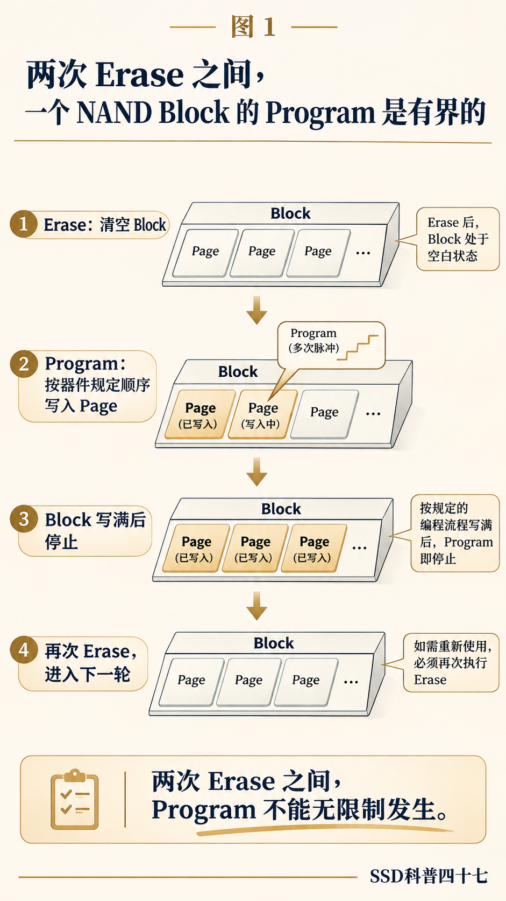
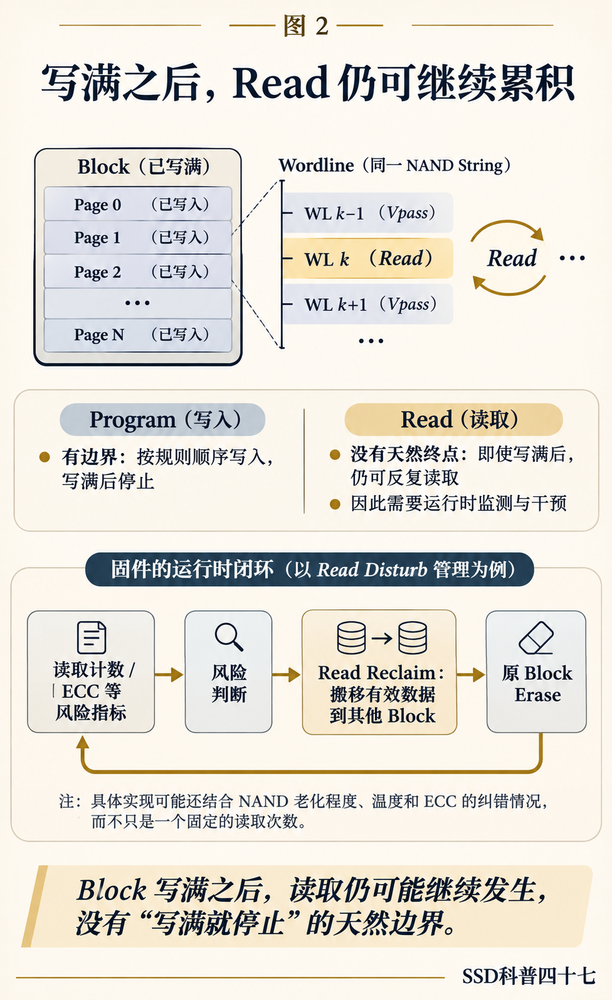
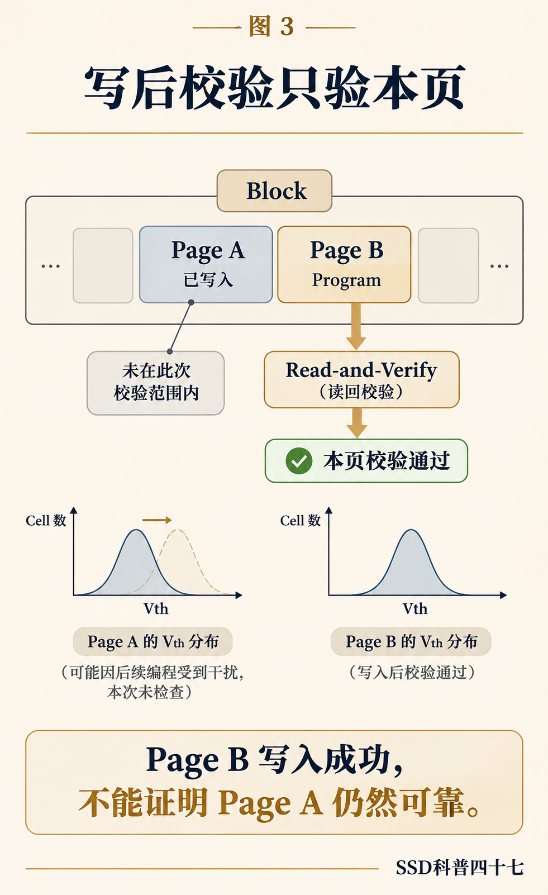

&nbsp;
<section style="font-family: -apple-system-font, BlinkMacSystemFont, &#39;Helvetica Neue&#39;, &#39;PingFang SC&#39;, &#39;Hiragino Sans GB&#39;, &#39;Microsoft YaHei UI&#39;, &#39;Microsoft YaHei&#39;, Arial, sans-serif;font-size: 16px;line-height: 1.75;text-align: left;">
<em data-pm-slice="0 0 []" style="-webkit-tap-highlight-color: rgba(0, 0, 0, 0);margin: 0px;padding: 0px;outline: 0px;max-width: 100%;box-sizing: border-box !important;overflow-wrap: break-word !important;font-style: italic;color: rgb(63, 63, 63);font-family: -apple-system-font, BlinkMacSystemFont, &quot;Helvetica Neue&quot;, &quot;PingFang SC&quot;, &quot;Hiragino Sans GB&quot;, &quot;Microsoft YaHei UI&quot;, &quot;Microsoft YaHei&quot;, Arial, sans-serif;font-size: inherit;font-variant-ligatures: normal;font-variant-caps: normal;font-weight: 400;letter-spacing: 1.6px;orphans: 2;text-align: left;text-indent: 0px;text-transform: none;widows: 2;word-spacing: 0px;-webkit-text-stroke-width: 0px;white-space: normal;text-decoration-thickness: initial;text-decoration-style: initial;text-decoration-color: initial;background-color: rgb(255, 255, 255);visibility: visible;">全文约 3000字｜阅读约 15 分钟</em>

读过第三十七篇的读者，大概还记得 Read Disturb（读取干扰）的那套管理流程：Block 被反复读取，固件跟踪读取次数，达到一定条件后，就把其中的有效数据搬移到其他 Block，再对原 Block 执行 Erase（擦除）。

而前面介绍 NAND program disturb时，我们也讨论过另一种情况：写入一个 Cell，可能影响那些本来不应该被编程的 Cell。

两边都叫 Disturb。一边固件要记账、搬移，另一边却很少看到与之对应的 Program Disturb计数和回收机制。

问题就来了：

<strong style="color: #0F4C81;font-weight: bold;font-size: inherit;">为什么固件要管理 Read Disturb，却很少单独管理 Program Disturb？</strong>

难道写入干扰不会造成数据错误吗？

当然会。

真正的区别，不在于哪一种干扰更严重，而在于它们发生的条件不同：<strong style="color: #0F4C81;font-weight: bold;font-size: inherit;">一种干扰可以随着后续读取不断积累，另一种干扰的正常暴露范围则受到 NAND 编程流程的约束。</strong>

这篇文章不再重新介绍干扰产生的物理机制，而是从 SSD Firmware（固件）的角度，讨论为什么两种干扰采用了不同的管理策略。
<h2 data-heading="true" style="display: table;padding: 0 0.2em;margin: 4em auto 2em;color: #fff;background: #0F4C81;font-size: 19.2px;font-weight: bold;text-align: center;">一、一个 Block 究竟能被 Program 多少次？</h2>
先从一次正常的 Block 写入过程说起。

假设 SSD 刚刚对某个 Block 执行了 Erase，准备重新写入数据。固件按照 NAND 规定的编程顺序，将数据逐步写入不同的 Page。

在这个过程中，确实可能发生 Program Disturb。

这里先明确一下范围：本文讨论的狭义 Program Disturb，是指选中某根 Wordline（字线，简称 WL）进行编程时，处于 Program Inhibit（编程抑制）状态的其他 Cell，仍然发生了非预期的电荷变化。

虽然 NAND 已经通过编程抑制机制减小这些 Cell 所承受的有效电场，但这种抑制并不是绝对完美的。它们仍然可能发生少量弱编程，导致 Vth（Threshold Voltage，阈值电压）偏移。如果偏移足够大，就可能造成数据错误。

Pass Disturb也可能发生在编程过程中，但它属于另一种干扰机制，不应与狭义 Program Disturb 混为一谈。

那么，既然编程干扰确实存在，为什么固件通常不需要专门统计它的次数？

关键在于：

<strong style="color: #0F4C81;font-weight: bold;font-size: inherit;">一个 Block 在两次 Erase 之间，并不能无限制地执行 Program。</strong>

NAND 对 Page 的编程顺序、允许的编程次数，以及 Partial-page Programming（部分页编程）等操作都有相应限制，具体要求取决于 NAND 器件及其编程模式。

例如，某些 NAND 要求 Page 按照指定顺序编程，不允许随意对已经写入的 Page 再次执行普通 Program。

当一个 Block 完成规定的编程流程后，如果需要重新使用其中的存储单元，通常必须先执行 Erase。

这就意味着，正常编程过程中的干扰暴露机会是受到约束的。

当然，这并不代表 Program Disturb 不会累积。

一次 Program 命令内部，NAND 可能执行多个高压编程脉冲。即使是处于 Inhibit 状态的 Cell，随着编程脉冲增加，仍然可能产生一定程度的弱编程效应。

<strong style="color: #0F4C81;font-weight: bold;font-size: inherit;">脉冲越多，弱编程影响可能越明显；但这些脉冲发生在受到器件规则约束的编程流程中。</strong>

NAND 厂商可以围绕合法的编程顺序、编程次数和器件工作条件，设计相应的干扰抑制机制，并对相关可靠性进行验证。

所以，这里的「有界」并不是说没有干扰，而是说正常编程过程中的干扰暴露范围可以受到约束。

需要注意，Erase 可以重置当前存储状态下的干扰偏移，让 Block 进入新的编程周期，但它并不能消除之前 P/E Cycle（编程/擦除循环）造成的器件老化。
<section style="text-align: center;" nodeleaf=""></section><h2 data-heading="true" style="display: table;padding: 0 0.2em;margin: 4em auto 2em;color: #fff;background: #0F4C81;font-size: 19.2px;font-weight: bold;text-align: center;">二、Read Disturb 为什么不一样？</h2>
现在换一个场景。

假设一个 Block 已经写满，里面保存着一份经常被访问的数据。

此后，即使 SSD 不再向这个 Block 写入新数据，Host（主机）仍然可能不断读取它。

读取一次，不需要重新擦除 Block。读取一万次，也不会因为读取次数增加而必须执行 Erase。

只要数据仍然有效，读取操作就可能继续发生。

但 NAND 在读取某一根 WL 上的数据时，通常需要给同一条 NAND String（NAND 存储串）中的其他未选中 WL 施加 Vpass（Pass Voltage，通过电压），让对应 Cell 保持导通。

这个电压虽然低于编程时的高压，但仍然可能对存储单元产生影响。

一次读取造成的变化可能很小，但如果同一个 Block 被反复读取，这种影响就可能逐渐积累，最终导致部分 Cell 的 Vth 偏移，甚至造成读取错误。

<strong style="color: #0F4C81;font-weight: bold;font-size: inherit;">一个 Block 即使早已完成编程，仍然可能因为后续反复读取而持续承受新的干扰。</strong>

这就是 Read Disturb 与 Program Disturb 的重要区别。

Program 的正常操作次数受到编程规则约束，而 Read 没有一个类似「Block 写满就停止」的天然边界。

因此，对于需要管理 Read Disturb 的 SSD，固件通常会通过读取次数或其他风险指标跟踪 Block 的读取情况。

当读取次数达到设定阈值，或者 ECC（Error Correction Code，错误纠正码）的纠错情况表明风险增加时，固件就可能触发 Read Reclaim，将有效数据搬移到其他 Block。

搬移完成后，原 Block 可以执行 Erase，重新进入空闲块池。

这实际上形成了一套运行时管理流程：

<strong style="color: #0F4C81;font-weight: bold;font-size: inherit;">读取计数 → 风险判断 → 搬移有效数据 → Erase。</strong>

不同 SSD 的具体实现可能有所区别，有些会结合 NAND 老化程度、温度和 ECC 纠错情况共同判断，而不只是依赖一个固定的读取次数。

但它们要解决的问题是相同的：读取操作可能在数据保存期间不断重复，因此固件需要考虑如何限制这种持续积累的风险。
<section style="text-align: center;" nodeleaf=""></section><h2 data-heading="true" style="display: table;padding: 0 0.2em;margin: 4em auto 2em;color: #fff;background: #0F4C81;font-size: 19.2px;font-weight: bold;text-align: center;">三、很少单独管理，不等于完全不管</h2>
讲到这里，可能会产生一个误解。

既然 Program Disturb 的正常暴露范围受到限制，那么固件是不是只要把数据交给 NAND，剩下的就完全不用管了？

当然不是。

<strong style="color: #0F4C81;font-weight: bold;font-size: inherit;">FW 不需要专门维护一套 Program Disturb 计数器，并不意味着它对编程可靠性没有责任。</strong>

首先，NAND 内部本身就承担着编程干扰的抑制工作。

例如，Program Inhibit 用来减轻不需要编程的 Cell 所受到的电场影响。ISPP（Incremental Step Pulse Programming，逐步增幅脉冲编程）则通过逐步施加编程脉冲，并在脉冲之间执行校验，让目标 Cell 达到要求的编程状态。

这些机制主要由 NAND 内部编程算法执行。固件发出页级 Program 命令，并根据 NAND 的执行状态处理后续流程，而不是直接控制每一个编程脉冲的电压和时序。

其次，固件必须遵守 NAND 的编程规则。

如果某颗 NAND 规定了 Page 的编程顺序、允许的编程次数和部分页编程限制，固件就必须按照要求执行。

随意改变编程顺序，或者超过器件允许的编程次数，都可能让实际干扰超出正常设计所考虑的条件。

另外，在某些采用两阶段编程的 MLC NAND 中，控制器还会通过 Shadow Program Sequencing（影子编程序列）安排不同 Page 的写入顺序，减少已经写入的 Cell 受到后续编程操作的耦合干扰。

这里需要特别区分：这种 Cell-to-Cell Program Interference（相邻单元编程耦合干扰）与本文讨论的狭义 Program Disturb 并不是同一种物理机制。

这说明固件确实可能在写入过程中主动管理编程相关干扰，只是管理的对象和方法不同。

写入完成后，固件还需要处理编程结果。

例如，Program Fail（编程失败）需要根据 NAND 状态和固件策略进行处理；ECC 则负责检测和纠正 NAND 中已经出现的位错误。

有些 SSD 还会在 Program 命令完成、NAND 返回 Ready 之后，执行 Read-and-Verify（读回校验），检查刚刚写入的数据是否正确。

但这里有一个容易忽略的细节：

<strong style="color: #0F4C81;font-weight: bold;font-size: inherit;">读回刚刚写入的 Page，并不能证明同一个 Block 中其他可能受到干扰的 Page 也都没有问题。</strong>

例如，编程 Page B 时，Page B 本身写入成功，但之前写入的 Page A 可能受到了一定程度的干扰。只验证 Page B，并不能证明 Page A 仍然可靠。

因此，写后校验只是检测手段之一，不能替代器件本身的可靠性设计。
<section style="text-align: center;" nodeleaf=""></section>
除此之外，一些控制器还会根据读取时 ECC 的纠错情况判断是否需要刷新或搬移数据。如果某个 Page 因为编程相关干扰产生了较多错误，也可能触发这种通用可靠性管理机制。

所以这里需要区分两个概念：

<strong style="color: #0F4C81;font-weight: bold;font-size: inherit;">没有专门的 Program Disturb 计数器，不等于 Program Disturb 造成的错误永远不会触发数据搬移。</strong>

前者说的是没有一套独立的干扰累计管理机制，后者说的是错误发生后仍然可能通过通用的可靠性机制进行处理。
<h2 data-heading="true" style="display: table;padding: 0 0.2em;margin: 4em auto 2em;color: #fff;background: #0F4C81;font-size: 19.2px;font-weight: bold;text-align: center;">四、为什么两种 Disturb 采用了不同的管理方式？</h2>
现在，我们可以重新回答文章最开始的问题。

Program Disturb 和 Read Disturb 都可能让 NAND Cell 的 Vth 发生非预期变化，严重时都可能造成数据错误。

但它们给 SSD Firmware 带来的管理问题并不相同。

对于 Program Disturb，正常编程操作受到 NAND 编程顺序和次数的约束。固件的主要职责是遵守器件要求，正确调度编程操作，并通过相应的可靠性机制处理剩余风险。

对于 Read Disturb，即使数据已经完成写入，后续读取仍然可能不断增加新的干扰风险。因此，固件通常还需要考虑在数据保存期间持续监测，并在必要时主动搬移数据。

前者主要依靠<strong style="color: #0F4C81;font-weight: bold;font-size: inherit;">编程过程中的预防和约束</strong>，后者则往往还需要<strong style="color: #0F4C81;font-weight: bold;font-size: inherit;">数据写入之后的持续监测与主动干预</strong>。

所以，我们很少看到一套与 Read Reclaim 完全对应的 Program Disturb 专用管理流程，并不是因为 Program Disturb 不重要，更不是因为 NAND 能够完全消除它。

而是因为两种干扰的发生条件、累积方式以及可以采取的控制手段不同。

<strong style="color: #0F4C81;font-weight: bold;font-size: inherit;">对于正常编程流程能够约束的干扰风险，主要依靠器件设计和操作规则进行控制；对于可能随着后续访问持续积累的干扰风险，固件则需要考虑额外的运行时管理机制。</strong>

这就是为什么 SSD 固件通常需要管理 Read Disturb，却很少单独管理 Program Disturb。

谢谢你读我的文章
</section>
&nbsp;
<section> </section>
<mp-style-type data-value="3"></mp-style-type>

