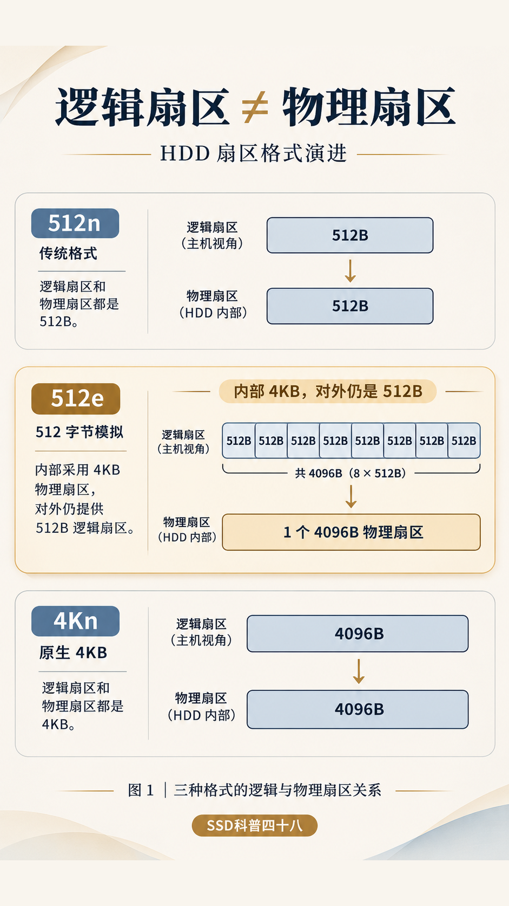
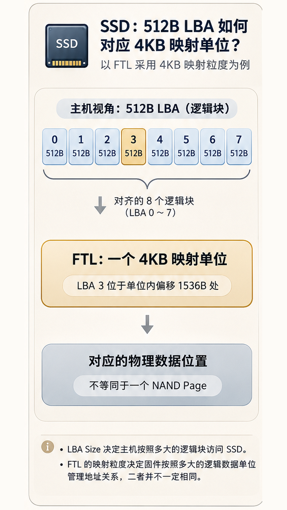

&nbsp;
<section style="font-family: -apple-system-font, BlinkMacSystemFont, &#39;Helvetica Neue&#39;, &#39;PingFang SC&#39;, &#39;Hiragino Sans GB&#39;, &#39;Microsoft YaHei UI&#39;, &#39;Microsoft YaHei&#39;, Arial, sans-serif;font-size: 16px;line-height: 1.75;text-align: left;">
以采用 4KB 映射粒度的 SSD 为例，固件按照一份份 4KB 数据记录它们的位置，但对主机却仍然可能提供 512B 逻辑块。

这就有点奇怪了。内部已经按照 4KB 管理，为什么不让主机也按照 4KB 访问，省去两种单位之间的转换？

答案不只在 SSD 内部，还得从几十年前的机械硬盘讲起。
<h2 data-heading="true" style="display: block;margin: 4em auto 2em;color: rgb(255, 255, 255);background: rgb(15, 76, 129);font-weight: bold;text-align: center;padding: 0.3em 1.2em;font-size: 20.8px;border-radius: 8px 24px;box-shadow: rgba(0, 0, 0, 0.06) 0px 2px 6px;width: fit-content;max-width: 100%;box-sizing: border-box;white-space: normal;word-break: break-word;">一、512B 为什么一直没有被淘汰？</h2>
早期磁盘并没有统一采用 512B，不同的扇区大小都曾经存在。随着个人电脑和硬盘技术的发展，512B 逐渐成为 PC 硬盘长期使用的标准。

时间久了，操作系统、驱动程序、启动代码、分区工具等，都逐渐形成了围绕 512B 建立的访问习惯。原本属于硬盘的一个技术参数，慢慢变成了整个软硬件生态共同遵守的约定。

如果突然换成另一种扇区大小，新硬盘接上电脑后，旧系统能不能启动？分区工具能不能正确识别？原来的数据能不能正常恢复？

这些都可能成为问题。

但硬盘技术并没有因此停止发展。

随着机械硬盘记录密度不断提高，512B 物理扇区逐渐显得不够划算。

我们平时说一个扇区是 512B，指的是它保存的用户数据。实际上，盘片上还需要同步信息、地址标记，以及 ECC（Error Correction Code，错误纠正码）等额外内容。

每保存 512B 数据，就需要付出相应的格式开销。如果把八个 512B 物理扇区合并为一个 4096B 扇区，原来重复出现的部分管理信息就可以减少，同时也有利于组织更有效的纠错保护。

于是，2010 年前后，采用 4KB 物理扇区的机械硬盘开始进入市场。这套技术被称为 Advanced Format（先进格式）。

从物理记录的角度看，硬盘已经有理由采用更大的扇区。

但问题来了：内部单位变了，为什么对外的单位不能一起变？

原因很简单。硬盘厂商可以推出新产品，却不能要求所有操作系统、驱动和工具在同一天完成升级。

于是，行业把原来看起来应该一起改变的两件事拆开了：<strong style="color: #0F4C81;font-weight: bold;font-size: inherit;">内部采用 4KB 物理扇区，对外仍然提供 512B 逻辑扇区。</strong>

这就是 512e（512-byte Emulation，512 字节模拟）。

一个 4KB 物理扇区对应八个连续的 512B 逻辑扇区。主机依然可以按照 512B 寻址，硬盘则负责处理两种单位之间的对应关系。

这样，许多旧软件仍然能够按照原来的方式访问硬盘，而不必全部重新设计。

另一条路线叫 4Kn（4K Native，原生 4KB），即逻辑扇区和物理扇区都是 4KB。它不再模拟 512B，但要求上层软件真正支持新的逻辑扇区大小。

所以，512e 和 4Kn 并存，并不是简单的先进与落后之分，而是不同使用环境对兼容性的要求不同。
<section style="text-align: center;" nodeleaf=""></section><h2 data-heading="true" style="display: block;margin: 4em auto 2em;color: rgb(255, 255, 255);background: rgb(15, 76, 129);font-weight: bold;text-align: center;padding: 0.3em 1.2em;font-size: 20.8px;border-radius: 8px 24px;box-shadow: rgba(0, 0, 0, 0.06) 0px 2px 6px;width: fit-content;max-width: 100%;box-sizing: border-box;white-space: normal;word-break: break-word;">二、到了 SSD，为什么还要保留 512B？</h2>
后来，存储介质从机械硬盘的磁盘盘片变成了 NAND Flash，但这个兼容性问题并没有自动消失。

SSD 仍然需要接入已有的操作系统、驱动和存储工具。它继承的是主机访问存储设备的逻辑接口，而不是机械硬盘的物理扇区结构。

在 NVMe 中，SSD 可以向主机报告自己支持的 LBA Format（逻辑块格式）。一些产品支持 512B 和 4096B，具体提供哪些格式取决于设备能力。

这里需要区分两个概念：<strong style="color: #0F4C81;font-weight: bold;font-size: inherit;">LBA Size 决定主机按照多大的逻辑块访问 SSD，FTL 的映射粒度则决定固件按照多大的逻辑数据单位管理地址关系。</strong>

二者并不一定相同，映射粒度也不等于 NAND Page 的大小。

例如，假设某个 SSD 的 FTL（Flash Translation Layer，闪存转换层）采用 4KB 映射粒度，而主机使用 512B LBA。

那么，对齐的八个 512B 逻辑块，比如 LBA 0～7，就可以归属于同一个 4KB 映射单位。

如果主机要访问其中的 LBA 3，固件可以根据逻辑地址确定它属于哪个 4KB 单位，以及它在这个单位中的位置。
<section style="text-align: center;" nodeleaf=""></section>
至于只更新其中 512B 时，固件怎样组织新旧数据，则取决于具体设计，我们留到下一篇再讲。

因此，SSD 内部采用 4KB 映射，并不意味着主机只能使用 4KB 逻辑块。同样，并不是所有 SSD 都必须采用 4KB 映射，或者同时提供 512B 和 4096B 两种格式。

回顾这段历史，我们会发现，512B 最初只是早期存储技术中的一种选择，后来却逐渐成为整个软件生态共同遵守的约定。

机械硬盘的物理扇区从 512B 走向 4KB，存储介质又从磁盘盘片变成 NAND Flash，但 512B 仍然以逻辑块大小的形式保留了下来。

<strong style="color: #0F4C81;font-weight: bold;font-size: inherit;">512B 活到今天，不是因为存储技术没有进步，而是因为已经建立起来的软件兼容性需求，不会随着硬件升级自动消失。</strong>

不过，当主机的写入粒度和内部管理粒度不一致时，也可能带来额外的处理开销。

下一篇，我们就来讨论 Read-Modify-Write（读—修改—写，简称 RMW）：为什么主机只修改一小部分数据，设备内部却可能需要处理更多的数据？

谢谢你读我的文章。
</section>
 

<mp-style-type data-value="3"></mp-style-type>

